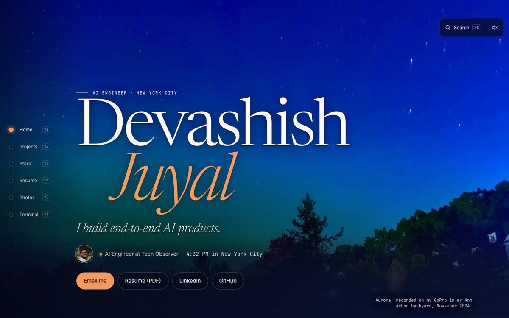
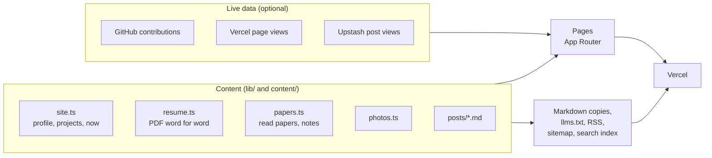

<div align="center">

# Devashish Juyal: personal site

**A fast, accessible night-sky portfolio: projects, résumé, papers read, photos and live GitHub data, with every page also available as markdown for people and agents.**

[**juyal-devashish.vercel.app →**](https://juyal-devashish.vercel.app) &nbsp;·&nbsp; [How it works](#how-it-works) &nbsp;·&nbsp; [Run it](#run-it) &nbsp;·&nbsp; [Edit content](#edit-content)


</div>



## How it works, in one page

- **What it is:** a personal site for an AI engineer, with the home page, projects (with silent demo loops), a résumé that matches the PDF word for word, a stack of papers read with notes, photos, a year-in-data page and a small terminal.
- **One source of truth:** every word comes from typed data in `lib/` and markdown in `content/`. The same data builds the pages, a markdown copy of each page, `llms.txt`, RSS, the sitemap and the ⌘K search index, so they never disagree.
- **Built to a bar:** zero axe violations in dark and light system settings, 44 px tap targets, no sideways scroll from 360 to 2560 px, reduced motion respected, and every page works without JavaScript.

---

## How it works



- **Pages** render from the data; live widgets render real data or nothing at all (sample data never reaches a production build).
- **Text routes** (`/projects.md`, `/resume.md`, `/llms.txt`, …) are built from the same data as the pages.
- **The old GitHub Pages address** (juyal-devashish.github.io) serves redirect stubs from the `gh-pages` branch, so old deep links land on the matching new anchor.

## Features

- **Home:** an aurora timelapse hero, a Now card, featured projects with demo loops, the GitHub contribution calendar (with a 3D "Skyline" view), three papers and a photo teaser.
- **Projects:** a featured project with its sketch, cards with silent demo videos, and a 26-week activity calendar.
- **Résumé:** the PDF's text word for word (checked by a test), with "More" sections that add detail from each project's repository, and a Print button that prints the PDF itself.
- **Stack:** papers read, ranked by citation count, as a pile of first pages with a dialog per paper and deep links by slug.
- **Photos, year in data and a terminal:** a gallery with a lightbox, a yearly summary from live data, and the site as a small shell at `/cmd`.
- **Search:** a ⌘K palette over every page, project, role, paper and photo.

## Tech stack

| Layer | Technology |
|---|---|
| Framework | Next.js 16 (App Router), React 19, TypeScript (strict) |
| Styling | Plain CSS and CSS modules, colour and font tokens in `app/globals.css` |
| Live data | GitHub GraphQL (contributions), Vercel Web Analytics API, Upstash Redis |
| Quality | `node --test` unit tests, `tsc`, an axe + layout checker across 12 screen sizes, a palette checker |
| Hosting | Vercel; GitHub Pages for the legacy redirects |

## Run it

**Prerequisites:** Node 20+.

```bash
git clone https://github.com/juyal-devashish/juyal-devashish.github.io.git && cd juyal-devashish.github.io
npm ci
npm run dev                                   # http://localhost:3000
```

| Command | What it does |
|---|---|
| `npm test` | Unit tests (text routes, search index, résumé vs. PDF, GitHub, store, year) |
| `npx tsc --noEmit` | Type check (run `npx next typegen` first on a fresh clone) |
| `npx next build && npx next start -p 3200` | Production build, then: |
| `npm run check` | axe (dark and light), tap targets, sideways scroll, h1, no-JS, text routes, screenshots at 12 sizes |
| `npm run check:palette` | Search palette behaviour, and every search-index link resolves to a page with that anchor |

CI (`.github/workflows/checks.yml`) runs typegen, tsc, unit tests and the build.

## Edit content

| What | Where |
|---|---|
| Profile, projects, Now, nav | `lib/site.ts` |
| Résumé page | `lib/resume.ts` (the PDF layer must match `public/assets/devashish-juyal-resume.pdf`; see `tests/resume.test.ts`) |
| Papers | `lib/papers.ts` (only `read: true` papers appear) |
| Photos | `lib/photos.ts` and `public/assets/img/photos/` |
| Posts | `content/posts/<slug>.md` with `title`, `date`, `summary` front matter |

## Live data (optional)

Set in Vercel (see `.env.example`). Without a variable, its widget is simply not shown.

| Variable | For |
|---|---|
| `NEXT_PUBLIC_SITE_URL` | Absolute links. Default `https://juyal-devashish.vercel.app` |
| `GITHUB_TOKEN` | Contribution calendar (recommended; without it the public calendar page is used, and a year it can't fully cover is hidden) |
| `KV_REST_API_URL`, `KV_REST_API_TOKEN` | Upstash store for post views |
| `VERCEL_ANALYTICS_TOKEN`, `VERCEL_PROJECT_ID`, `VERCEL_TEAM_ID` | Page views on the year page |

## Repository layout

```
app/              routes: home, projects, stack, résumé, photos, now, year, cmd, text routes, OG images
components/       shared UI (rail, palette, lightbox) and per-page components; see components/README.md
lib/              all content and data access (site, résumé, papers, photos, posts, GitHub, views, search text)
content/posts/    markdown posts
public/assets/    images, demo videos, the résumé PDF
tests/            unit tests and fixtures
tools/            the axe/layout checker, the palette checker, the legacy-pages generator
legacy-pages/     redirect stubs served by GitHub Pages from the gh-pages branch
```

## License

The code is [MIT](LICENSE) licensed. The photos, writing, résumé and other personal content are © Devashish Juyal, all rights reserved.
